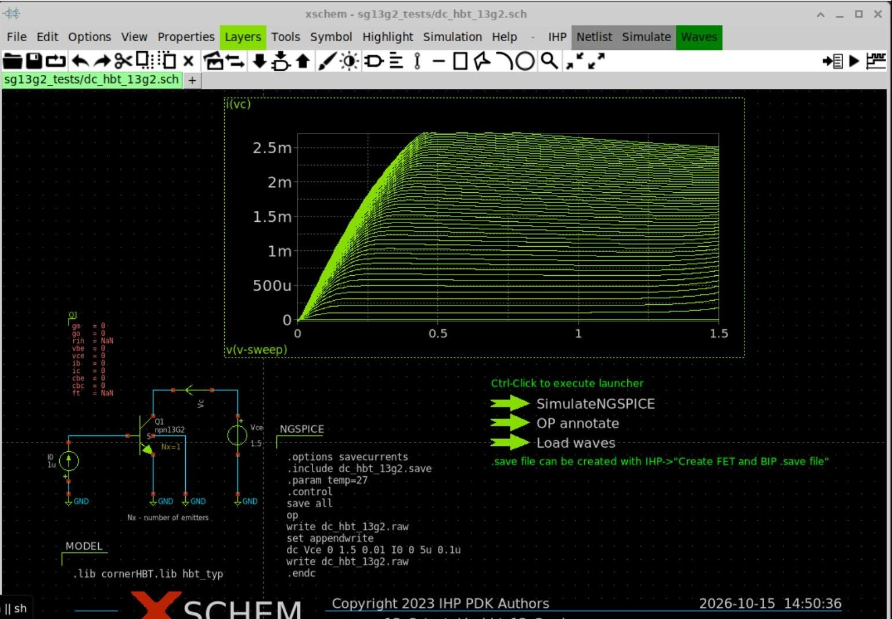
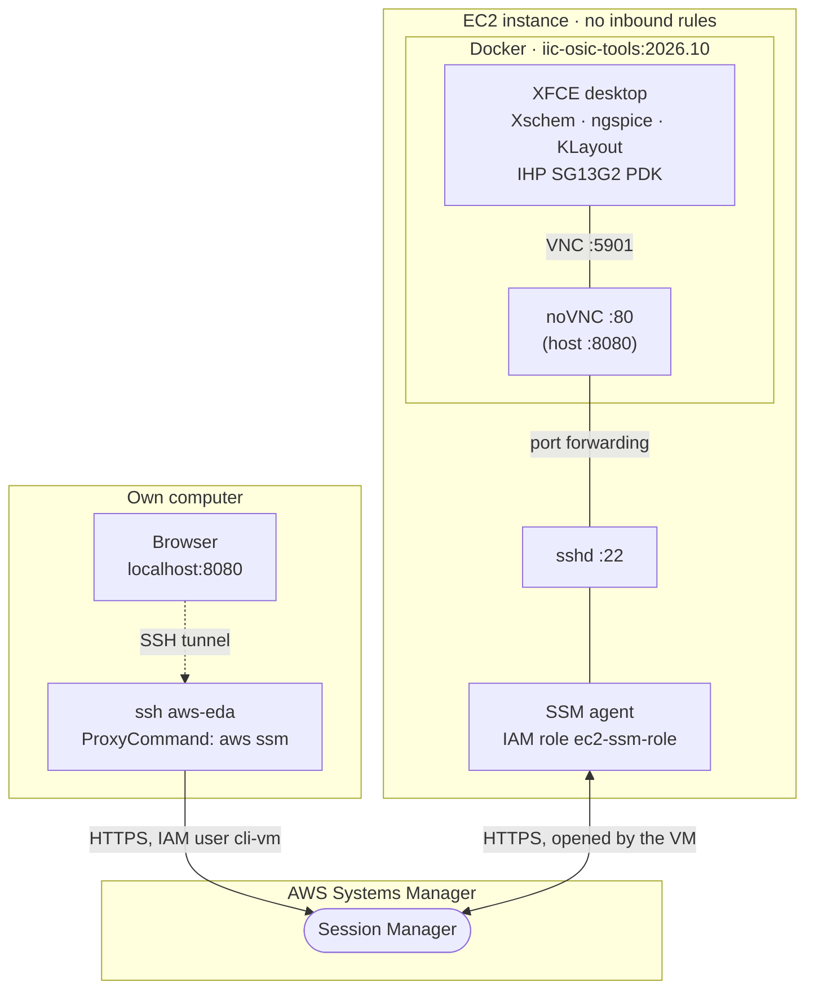
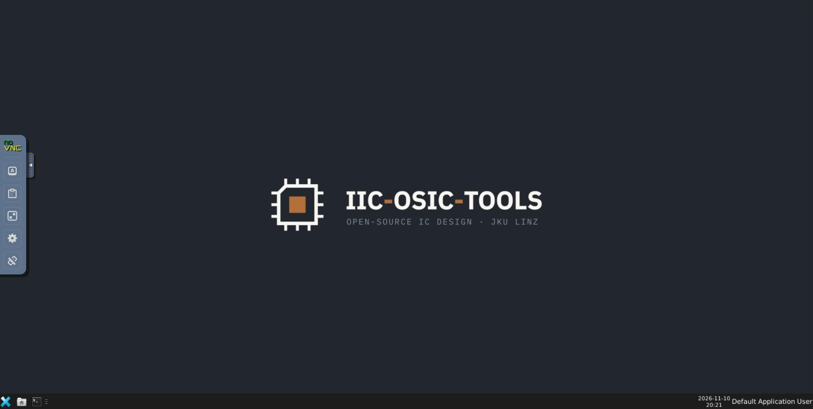
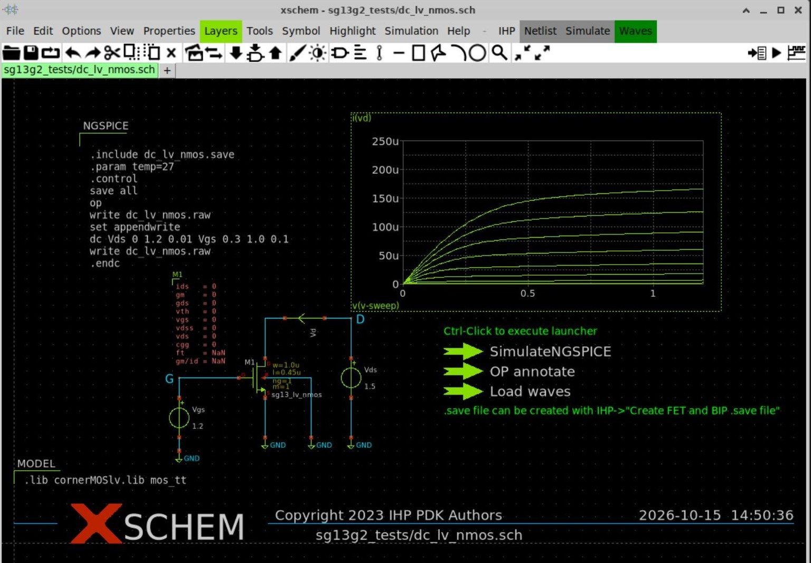
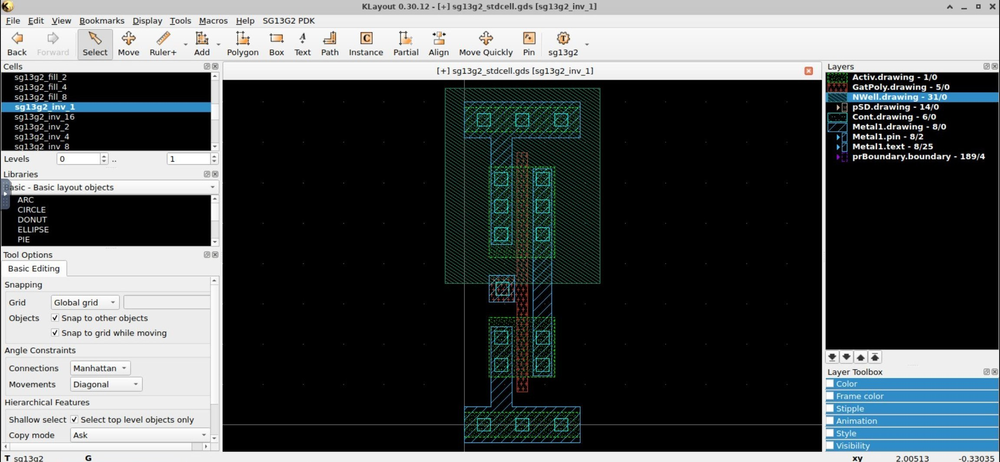

# ihp-cloud-eda

A browser-based IC design environment for the [IHP SG13G2 open PDK](https://github.com/IHP-GmbH/IHP-Open-PDK) on an AWS EC2 instance, using the [IIC-OSIC-TOOLS](https://github.com/iic-jku/IIC-OSIC-TOOLS) image (Xschem, ngspice, KLayout and more).

- **Reproducible:** one script ([`setup.sh`](setup.sh)) turns a fresh Ubuntu VM into the full environment, with a pinned image version.
- **Secure:** no open inbound port on the VM. Access only through AWS Systems Manager Session Manager with a narrowly scoped IAM user, the desktop is reached through an SSH tunnel.
- **Low effort for users:** a browser is all that is needed, no local tool installation.

<p align="center"></p>

## Contents

1. [Architecture](#architecture)
2. [Repository](#repository)
3. [Setup](#setup)
4. [Daily use](#daily-use)
5. [First simulation](#first-simulation)
6. [Pitfalls](#pitfalls)
7. [Costs](#costs)
8. [Possible improvements](#possible-improvements)
9. [Credits](#credits)

## Architecture



- Arrows show which side opens a connection, data flows both ways afterwards. Inside the VM, plain lines show the path from the SSM agent to the desktop.
- The VM opens the connection to Systems Manager itself (outbound HTTPS). Nothing listens on the internet.
- The own computer also connects outbound only, AWS checks the IAM key instead of an IP address. Changing IP addresses (home, mobile, other locations) do not matter.
- SSH runs inside the Session Manager channel and carries the port forwarding for the desktop.
- The container runs with `--restart unless-stopped`, so the desktop comes back after a VM restart.

## Repository

| File | Runs on | Purpose |
|---|---|---|
| `setup.sh` | VM | installs Docker, pulls the pinned image, creates the desktop container |
| `aws-vm.sh` | own computer | `start` (start VM, wait for Session Manager, connect), `stop`, `status` |
| `aws-vm.env.example` | own computer | template for the instance ID (copy to `aws-vm.env`, not in Git) |
| `aws/cli-user-policy.json` | AWS IAM | permissions for the CLI user, limited to one VM |
| `aws/ssh-config.example` | own computer | SSH host entry with ProxyCommand and tunnel |

## Setup

### 1. EC2 instance

Launch an instance with Ubuntu Server LTS (x86_64), type `m7i-flex.large` (2 vCPU, 8 GB RAM) and a 30 GiB gp3 volume. The image needs about 17 GB.

For the first setup SSH can be allowed from the own IPv4 address. After step 4 this rule is removed.

### 2. IAM role for the VM

IAM → Roles → Create role → AWS service, use case EC2 → policy `AmazonSSMManagedInstanceCore` → name `ec2-ssm-role`. Then EC2 → instance → Actions → Security → Modify IAM role.

The SSM agent is preinstalled on Ubuntu images. After a few minutes the instance shows up as online in Systems Manager → Explore nodes.

### 3. IAM user for the CLI

IAM → Users → Create user `cli-vm` without console access, add an inline policy from [`aws/cli-user-policy.json`](aws/cli-user-policy.json) (replace `<REGION>`, `<ACCOUNT_ID>`, `<INSTANCE_ID>`), create an access key for the CLI.

The key can only start, stop and connect to this one VM. It cannot terminate instances, create resources or change anything else.

### 4. Tools on the own computer

```bash
sudo snap install aws-cli --classic
curl -fsSL "https://s3.amazonaws.com/session-manager-downloads/plugin/latest/ubuntu_64bit/session-manager-plugin.deb" -o /tmp/session-manager-plugin.deb
sudo apt install /tmp/session-manager-plugin.deb
aws configure    # access key of cli-vm, region eu-central-1
```

Add the host entry from [`aws/ssh-config.example`](aws/ssh-config.example) to `~/.ssh/config` with your instance ID, then `ssh aws-eda`. Once this works, delete the SSH rule from the security group.

### 5. Environment on the VM

```bash
scp setup.sh aws-eda:~
ssh aws-eda
 VNC_PW='password-for-desktop' ./setup.sh
```

The leading space keeps the password out of the shell history (with Ubuntu's default `HISTCONTROL`). The script can be run again, for example for a new password; it only recreates the container.

## Daily use

```bash
cp aws-vm.env.example aws-vm.env   # once, enter the instance ID
./aws-vm.sh start                  # start the VM and connect
./aws-vm.sh status
./aws-vm.sh stop                   # stop the VM, the disk is kept
```

While connected, open <http://localhost:8080> and log in with the desktop password (`password-for-desktop` from the setup). The desktop container starts together with the VM.

## First simulation

In a terminal on the desktop:

```bash
sak-pdk ihp-sg13g2
xschem $PDKPATH/libs.tech/xschem/sg13g2_tests/dc_lv_nmos.sch &
```

`sak-pdk` selects the PDK and sets the environment for Xschem, ngspice and KLayout. In the IHP test schematics, Ctrl-click the launcher **SimulateNGSPICE**, then **Load waves**.

| | |
|---|---|
|  |  |
| Desktop in the browser (noVNC) | NMOS output characteristics (`dc_lv_nmos`) |
|  |  |
| SiGe HBT, I<sub>C</sub> over V<sub>CE</sub> (`dc_hbt_13g2`) | Standard cell `sg13g2_inv_1` in KLayout |

## Pitfalls

Things that cost time during the setup and that new users will likely run into as well:

- **"My IP" picks IPv6.** The EC2 console suggested the browser's IPv6 prefix for the SSH rule, but the VM only has IPv4, so SSH timed out. Home connections also change their IPv4 address regularly. Session Manager removes the problem completely.
- **"Simulate" fails in the IHP examples.** The netlist includes a `.save` file that only the schematic's own **SimulateNGSPICE** launcher creates. The standard Netlist/Simulate buttons end with `Could not find include file ….save`, and "Load waves" stays empty without results.
- **Logout inside the desktop** ends the VNC session and the container. With `--restart unless-stopped` it comes back by itself.
- **Password limits.** The start script passes `VNC_PW` unquoted to Docker, so it must not contain spaces, and it is visible via `docker inspect`.
- **`latest` is a moving target.** The image tracks the `dev` branch of the IHP PDK, so a pinned tag such as `2026.10` is needed for courses or tapeouts that must stay reproducible.
- **KLayout shortcuts.** Zoom fit is `f`, full hierarchy is `Shift+F` (also in the Display menu). Click into the drawing area first so KLayout has the keyboard focus.

## Costs

On an AWS free plan account everything is paid from the credits:

| Item | Approx. cost |
|---|---|
| `m7i-flex.large` while running | 0.115 $/hour |
| public IPv4 while running | 0.005 $/hour |
| 30 GiB gp3 volume (also while stopped) | 2.90 $/month |
| IAM, Session Manager | free |

Stopping the VM after use keeps the cost at a few dollars per month.

## Possible improvements

- **Infrastructure as code** (Terraform or CloudFormation) for the instance, role, user and security group instead of console clicks.
- **Many users:** one container per user behind a login (for example JupyterHub or Apache Guacamole) instead of a shared desktop password.
- **Auto stop** when idle, to avoid forgotten running instances.
- **CI run of `setup.sh`** on a fresh instance for each new image tag.
- **No public IPv4** by using VPC endpoints for Systems Manager (more cost, but no public address at all).

## Credits

- [IIC-OSIC-TOOLS](https://github.com/iic-jku/IIC-OSIC-TOOLS) by the Department for Integrated Circuits, Johannes Kepler University Linz
- [IHP Open PDK](https://github.com/IHP-GmbH/IHP-Open-PDK) by IHP Microelectronics
- Example schematics and the inverter cell are part of the IHP Open PDK
